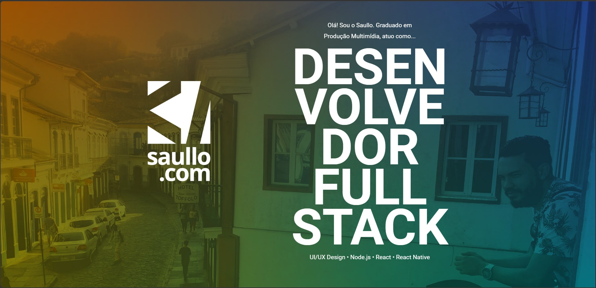

# saullo.com

Site pessoal e portfólio de **Saullo Bueno**, desenvolvedor Full Stack (UI/UX Design · Node.js · React · React Native). É uma página única (SPA) que conta minha trajetória, minha expertise técnica e reúne os projetos que já entreguei.



## O que tem no site

- **Sobre** (minha trajetória): origem, formação em Produção Multimídia (2012) e a evolução do design gráfico e front-end para a engenharia de software Full Stack.
- **Habilidades** (expertise técnica): design e UI/UX, front-end, back-end, mobile, qualidade e CI/CD, arquitetura e performance.
- **Serviços** (o que faço): visão do ciclo completo de um produto digital, da concepção visual ao desenvolvimento.
- **Projetos** (portfólio):
  - **Projetos**: aplicações full stack com IA publicadas e com código aberto (Forge, FieldOps, Nexus Developer Platform, Product Analytics OS, AI Customer Operations Platform, Command Center e AI Workflow Studio). Cada card traz descrição, destaques, stack, links para o GitHub e a demo ao vivo, além de uma galeria de screenshots reais com miniaturas e lightbox com zoom.
  - **Projetos Legados**: sites e identidades criados para clientes, exibidos em lightbox, com opção de "ver mais".
- **Contatos**: e-mail, LinkedIn, WhatsApp e GitHub.
- **Palco de cenas**: o hero fica fixo, ocupando a tela inteira, e o resto do site é uma sequência de "cenas". Qualquer gesto de rolagem (roda, trackpad, teclado, deslizar o dedo ou arrastar a barra), por menor que seja, avança ou volta uma cena inteira; os gestos seguintes só valem depois de uma pequena trava, para a cena nova entrar. Ao primeiro gesto aparece no centro da tela uma caixa escura, translúcida e embaçada (blur) na frente do hero, só para dar leitura ao conteúdo. Os elementos de cada cena entram em sequência e, ao sair, vão embora com movimento (cada projeto em destaque tem a sua cena). O componente `Palco` (`src/components/palco`) marca cada `.cena` com `data-estado` (`antes`, `ativa`, `depois`) e todo o movimento é CSS por tempo em `src/index.css`, aplicado com o helper `revelar()` (`src/components/reveal`) e as classes `rv-*`. Só a cena atual e as vizinhas são renderizadas (e carregam suas imagens), e o texto que não couber na caixa tem a fonte reduzida automaticamente. Sem JavaScript, com `prefers-reduced-motion` ou em telas com menos de 500px de altura, o palco não liga e a página é um fluxo comum de seções.
- **Barra de rolagem** estilizada em vidro: trilho e polegar translúcidos. No palco a nativa é escondida. No lugar entra uma coluna de pontos de vidro na lateral direita, um por cena, que marca a cena atual, mostra o nome ao passar o mouse e salta para a cena ao tocar ou clicar; no celular ela é mais fina e fica dentro da caixa.
- **Cabeçalho transparente**: logo e menu em letras menores (e o conjunto à direita também), sem fundo. Fica oculto no topo e aparece depois da primeira rolagem; os links levam ao ponto de repouso da primeira cena da seção. Link "pular para o conteúdo" e revelação pelo primeiro Tab para quem usa teclado.
- **Sem rodapé**: no palco, só uma linha pequena na base da tela, sobre o hero: "Design e código 100% autorais" na extrema esquerda e o copyright na direita (com folga da barra de rolagem).
- **Métricas de acesso** com Vercel Web Analytics (sem cookies) e só fora de localhost. Precisa estar ativado no painel da Vercel (Analytics → Enable).
- **Dois idiomas**: português em `/` e inglês em `/en`, com `hreflang`, canonical e sitemap para cada um.

## Tecnologias

React 19.3 (com React Compiler) · React Router 8 (modo framework, SSG) · TypeScript 6 · Vite 8 · Tailwind CSS v4 · react-icons · [yet-another-react-lightbox](https://yet-another-react-lightbox.com/) · Playwright + axe-core (testes) · Prettier · ESLint 10

## Como rodar

```bash
npm install
npm run dev       # servidor de desenvolvimento
npm run build     # build de produção com HTML pré-renderizado (SSG) em build/client/
npm run preview   # serve build/client em http://localhost:4173
npm run lint      # ESLint
npm run format     # Prettier
npm test           # testes e2e (Playwright + axe): exige npm run build antes
```

## Estrutura

```
public/                     Somente o que precisa de URL estável: favicon, social.jpg (Open Graph), robots.txt e sitemap.xml
docs/                       Imagens usadas só no README
scripts/                    Geração da imagem social e otimização de imagens (AVIF)
src/
  assets/                   Imagens do site (processadas pelo Vite, com hash e cache imutável)
    legacy/                 Projetos legados: portfolio-web-<slug>.avif e portfolio-web-<slug>-g.avif
    portfolio/<projeto>/    Screenshots de cada projeto em destaque
  components/               Nav, Header, Footer, Section, FeaturedCard, ProjectGallery, LegacyGallery, Lightbox e HomePage
  data/
    featuredProjects.ts     Projetos em destaque (veja abaixo)
    portfolio.json          Trabalhos anteriores (sites de clientes)
  root.tsx                  Layout HTML, metas (SEO/Open Graph/JSON-LD) e ErrorBoundary
  routes.ts                 Tabela de rotas do React Router
  i18n/                     Textos: pt.ts (fonte da verdade) e en.ts (tipado contra pt), contexto e SEO por idioma
  routes/home.tsx           Rota / (pt) e routes/home.en.tsx (en): ambas renderizam components/homePage
  routes/not-found.tsx      Rota coringa (404)
  styles/                   Estilos globais
```

## Como adicionar um projeto em destaque

Os projetos em destaque ficam em `src/data/featuredProjects.ts`, um arquivo TypeScript com a lista `featuredProjects` e a interface `FeaturedProject`. Ele foi criado junto com a reformulação da seção de portfólio (commit `8e7cd08`) e é lido diretamente por `src/routes/home.tsx`: não é gerado automaticamente nem vem de nenhuma biblioteca.

Para incluir um novo projeto:

1. Coloque os screenshots em `src/assets/portfolio/<slug-do-projeto>/`.
2. Importe as imagens no topo de `featuredProjects.ts`.
3. Adicione um objeto à lista `featuredProjects` com `slug`, `title`, `subtitle`, `description`, `highlights`, `stack`, `githubUrl`, `demoUrl` (opcional) e `images`.

A ordem da lista é a ordem exibida no site.

## Deploy (Vercel)

O site é estático: `vercel.json` aponta a saída para `build/client` e define o comando de build (`npm run build`). O que ele configura:

- **Cabeçalhos de segurança** em todas as rotas: CSP, `X-Content-Type-Options`, `X-Frame-Options`, `Referrer-Policy` e `Permissions-Policy` (o HSTS já é enviado pela própria Vercel). A CSP mantém `'unsafe-inline'` em `script-src` e `style-src` porque o React Router injeta scripts de hidratação no HTML.
- **Cache imutável** (1 ano) para `/assets/*`, que têm hash no nome.
- **404 real**: o `postbuild` copia o fallback de SPA para `404.html`, que a Vercel serve com status 404 para qualquer caminho inexistente.

`npm test` aplica os cabeçalhos do `vercel.json` nas respostas e falha se a CSP bloquear algum recurso.

## Como mudar textos e idiomas

- Textos da página: `src/i18n/pt.ts` e `src/i18n/en.ts`. O inglês só compila se tiver as mesmas chaves do português.
- Textos dos projetos em destaque: português em `src/data/featuredProjects.ts` e inglês em `src/data/featuredProjects.en.ts` (por `slug`).
- Um novo idioma exige: arquivo de mensagens, entrada em `messages.ts`, rota em `routes.ts`, item em `prerender` (`react-router.config.ts`) e no `sitemap.xml`.
